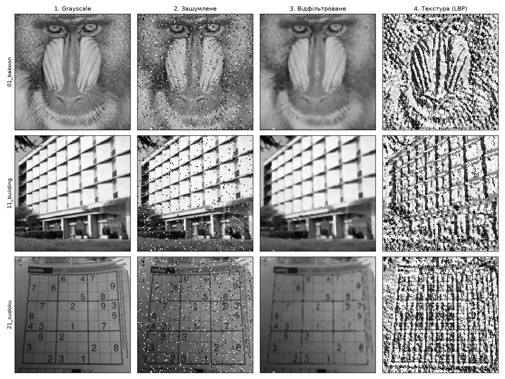
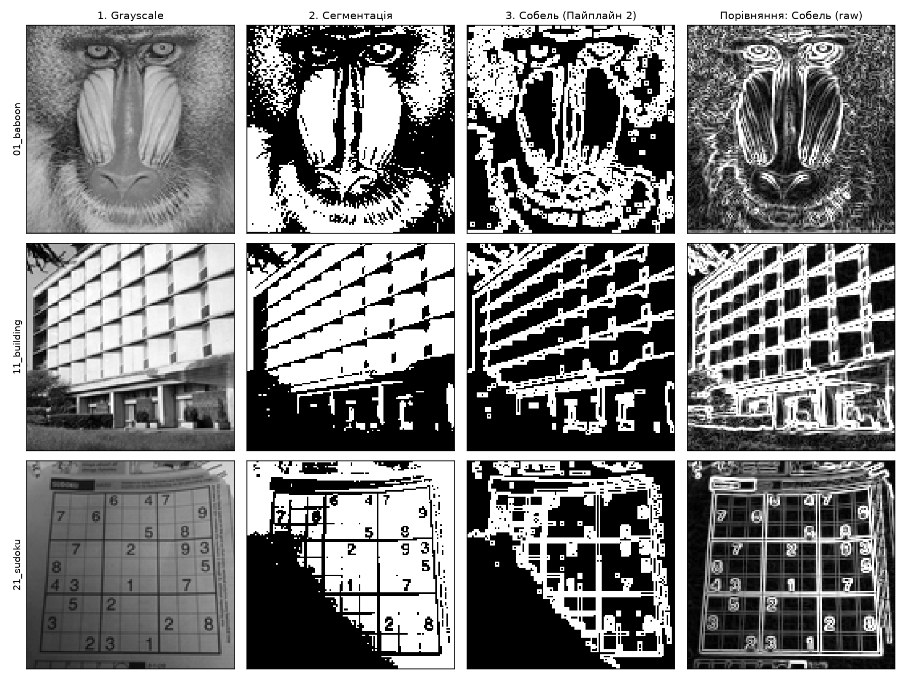
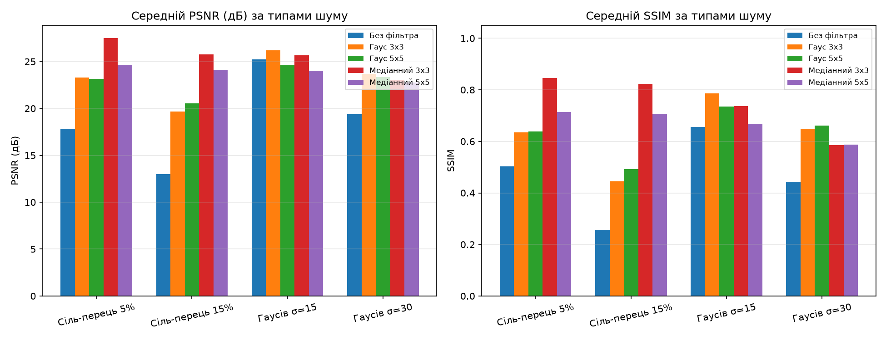
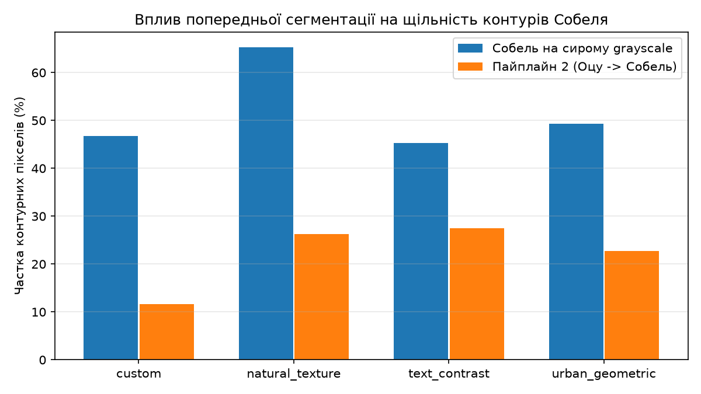

# Звіт з індивідуального STEM-проєкту з дисципліни «Комп'ютерна графіка»

**Тема:** Аналіз та обробка зображень за допомогою класичних методів фільтрації, сегментації та аналізу текстур  
**Виконавець:** Кривенко Андрій (`andrcry`, `andriikrivenko@gmail.com`)  
**Формат виконання:** Індивідуальний  
**Репозиторій (GitHub):** [https://github.com/andrcry/CGV_STEM_Project](https://github.com/andrcry/CGV_STEM_Project) (гілки `main`, `feature/pipelines`, `feature/tests-and-report`)

---

## 1. Технічне завдання (ТЗ)

| Параметр ТЗ | Зафіксоване рішення |
|---|---|
| **Тема проєкту** | Аналіз та обробка зображень за допомогою класичних методів фільтрації, сегментації та аналізу текстур |
| **Вибірка зображень** | 30 тестових зображень (`128×128`, формати `.png` та `.bmp`) з відкритої колекції OpenCV Samples (`natural_texture`, `urban_geometric`, `text_contrast`) |
| **Реалізовані конвеєри (Варіант 2)** | **Пайплайн 1:** Колірне перетворення (Grayscale) → Ін'єкція шуму (`seed=42`) → Ручна фільтрація (Медіанний / Гаусів) → Текстурний аналіз (`GLCM` + `LBP`)<br>**Пайплайн 2:** Колірне перетворення (Grayscale) → Порогова сегментація (Оцу / Глобальна) → Контурний аналіз (Оператор Собеля) |
| **Задіяні категорії методів** | 1) Колірна корекція; 2) Фільтрація зображень; 3) Аналіз текстур і статистичних ознак; 4) Сегментація зображень; 5) Контурний аналіз |
| **Очікуваний рівень складності (D1)** | **Просунутий / Експертний** ($k = 0.9\text{–}1.0$): понад 3 категорії методів, ручна реалізація всіх стадій без `cv2`/`scipy.ndimage`, обґрунтування параметрів, порівняння на 4 сценаріях шуму та текстурний аналіз `GLCM/LBP` |
| **Еталонні порогові критерії (C1)** | • Для імпульсного шуму 5%: відновлений PSNR $\ge 25\text{ дБ}$, приріст $\Delta\text{PSNR} \ge +6\text{ дБ}$, $\text{SSIM} \ge 0.80$<br>• На тестових матрицях $3\times 3$ / $5\times 5$: точний збіг з аналітичним розрахунком (відсутність аварій на $1\times 1$ та пошкоджених файлах) |

---

## 2. Анотація та ключові слова

**Анотація.** У роботі розроблено модульне програмне рішення на мові Python для класичної обробки та кількісного аналізу цифрових зображень без використання методів машинного навчання, нейронних мереж та вбудованих фільтрів бібліотек комп'ютерного зору. На основі коду попередніх лабораторних робіт (`CGV_4.py`, `CGV_5.py`, `CGV_6.py`) створено власні параметризовані реалізації 2D-згортки з крайовим падінгом, Гаусового та медіанного фільтрів, оператора Собеля, глобальної та автоматичної порогової сегментації Оцу, локальних бінарних шаблонів (LBP) і матриць спільної появи рівнів сірого (GLCM), а також метрик MSE, PSNR і локального SSIM. Проведено експериментальне оцінювання на 30 різнотипних зображеннях за чотирма сценаріями зашумлення. Результати підтвердили перевагу медіанної фільтрації $3\times 3$ при імпульсному шумі (середній $\text{PSNR} = 27.48\text{ дБ}$, $\text{SSIM} = 0.8467$ проти $23.31\text{ дБ}$ у Гауса) та ефективність Гаусової фільтрації $3\times 3$ при адитивному гаусовому шумі ($\text{PSNR} = 26.18\text{ дБ}$ при $\sigma=15$), а також виявили ефект стирання тонких однопіксельних текстових штрихів нелінійним медіанним вікном.

**Ключові слова:** комп'ютерна графіка, згортка зображень, Гаусів фільтр, медіанний фільтр, метод Оцу, оператор Собеля, GLCM, LBP, PSNR, SSIM.

---

## 3. Вступ та огляд суміжних наукових робіт

### 3.1. Актуальність та мета роботи
Класичні алгоритми обробки зображень залишаються фундаментом систем комп'ютерного зору в умовах обмежених обчислювальних ресурсів, детермінованих вимог до відтворюваності та потреби в математичній інтерпретованості результатів (бортова аерокосмічна оптика, промисловий контроль якості, попередня підготовка медичних і текстових сканів).

**Мета проєкту:** застосувати класичні методи комп'ютерної графіки для побудови двох автоматизованих конвеєрів обробки, реалізувати всі алгоритмічні стадії вручну, кількісно й візуально оцінити ефективність методів на різних класах зображень та визначити межі їхньої застосовності.

### 3.2. Огляд суміжних наукових робіт та порівняння підходів
Для позиціонування класичних алгоритмів відносно базових та сучасних підходів проаналізовано 7 наукових праць:

1. **Порогова сегментація — Otsu (1979)** [1]: запропонував непараметричний автоматичний вибір порога за максимумом міжкласової дисперсії гістограми. На відміну від фіксованого глобального порога ($T=127$), метод адаптується до середньої яскравості кадру, хоча й зберігає вразливість до нерівномірного освітлення.
2. **Аналіз текстур другого порядку — Haralick, Shanmugam & Dinstein (1973)** [2]: ввели матрицю спільної появи рівнів сірого (GLCM) та 14 статистичних ознак (контраст, однорідність, енергія/ASM, кореляція). Ці ознаки дозволяють кількісно виміряти втрату мікротекстур після згладжувальної фільтрації.
3. **Локальні текстурні дескриптори — Ojala, Pietikäinen & Mäenpää (2002)** [3]: сформулювали оператор локальних бінарних шаблонів (LBP), який кодує співвідношення інтенсивності центрального пікселя з круговою околицею та інваріантний до монотонних змін освітлення.
4. **Оцінка структурної якості — Wang, Bovik, Sheikh & Simoncelli (2004)** [4]: довели, що попіксельні похибки MSE та PSNR не завжди корелюють із людським зором, і запропонували індекс SSIM, який поєднує порівняння яскравості, контрасту й локальної структури.
5. **Оптимальне детектування контурів — Canny (1986)** [5]: розвинув класичні градієнтні оператори (зокрема Собеля) за рахунок попереднього Гаусового згладжування, придушення немаксимумів (NMS) та гістерезисної бінаризації. У Пайплайні 2 ми досліджуємо альтернативну схему: *попередня сегментація Оцу → оператор Собеля* для відсікання фонового текстурного шуму.
6. **Сучасна нейромережева фільтрація — DnCNN, Zhang et al. (2017)** [6]: застосували глибоке залишкове навчання CNN для оцінки шумової складової, досягаючи вищого PSNR на складному гаусовому шумі завдяки вивченим апріорним розподілам природних сцен, але ціною потреби у великих датасетах, GPU та відсутності гарантій поведінки на нетипових артефактах.
7. **Сучасна семантична сегментація — U-Net, Ronneberger et al. (2015)** [7]: архітектура енкодер-декодер зі skip-з'єднаннями формує попіксельні маски об'єктів складної форми незалежно від перепадів освітлення, що долає головне обмеження глобального порога Оцу, проте потребує розміченої навчальної вибірки.

| Підхід | Потреба у навчанні | Обчислювальна складність | Інтерпретованість | Поведінка на нерівномірному освітленні / складному шумі |
|---|---|---|---|---|
| **Ручні класичні методи (цей проєкт)** | Відсутня | Детермінована $O(H W k^2)$ на CPU | Повна (явні ядра й формули) | Чутливі до вибору розміру вікна та локальних тіней |
| **Глибоке навчання (DnCNN, U-Net)** | Великий розмічений датасет | Висока під час навчання, потребує GPU | Низька ("чорна скринька") | Висока стійкість у межах домену навчання |

---

## 4. Опис вибірки зображень

Для експериментів сформовано вибірку з **30 зображень** із відкритої колекції еталонних тестових зображень OpenCV (`opencv/samples/data`). Усі зображення стандартизовано шляхом квадратного центрування та приведення до роздільної здатності $128\times 128$ пікселів; 24 файли збережено у форматі `.png` і 6 файлів — у форматі `.bmp` (серед яких є як кольорові `RGB`/`RGBA`, так і монохромні `L` зображення).

Вибірку поділено на три змістові групи по 10 зображень:
1. **`natural_texture` (`01_baboon.png` – `10_fish.bmp`)**: природні об'єкти та сцени з різним рівнем деталізації — від дрібної високочастотної текстури шерсті (`01_baboon.png`, `08_starry_night.png`) до гладких поверхонь (`05_apple.png`, `06_orange.png`).
2. **`urban_geometric` (`11_building.png` – `20_stuff.bmp`)**: архітектурні об'єкти й геометричні структури з чіткими прямими гранями, періодичними решітками та різкими кутами (`11_building.png`, `15_blox.png`, `17_chessboard.png`).
3. **`text_contrast` (`21_sudoku.png` – `30_ellipses.bmp`)**: текстові документи, ноти, рукописні цифри, розмиті тексти та висококонтрастні форми (`21_sudoku.png`, `22_notes.png`, `23_text_normal.png`, `28_digits.png`).

---

## 5. Опис методів, пайплайнів та обґрунтування параметрів

### 5.1. Відмінність від лабораторних робіт №4–6
У попередніх роботах (`CGV_4.py`–`CGV_6.py`) реалізовувались інтерактивні скрипти з фіксованим ядром Гауса $3\times 3$ без обробки країв (`CGV_5.py`) або виклики вбудованих фільтрів `scipy.ndimage` (`CGV_6.py`). У цьому проєкті:
- **усі операції реалізовано вручну** у модулях `src/utils.py`, `src/filters.py`, `src/segmentation.py` без `scipy.ndimage` та `cv2`;
- додано **крайовий падінг `edge`** для збереження розміру матриці без темної рамки;
- реалізовано нові для курсу методи: параметризоване 2D-ядро Гауса, ручний медіанний фільтр, оператор Собеля, метод Оцу, локальні бінарні шаблони (LBP), матрицю GLCM та локальний індекс SSIM.

### 5.2. Архітектура пайплайнів

#### Пайплайн 1: Відновлення зашумлених зображень та аналіз збереження текстур
```text
[Вхід RGB/L] -> (1) to_grayscale -> [Ін'єкція шуму (seed=42)] -> (2) Фільтр (Median/Gaussian) -> (3) Аналіз текстур (GLCM + LBP)
                 Колірна корекція     Тестова деградація          Фільтрація зображень          Аналіз текстур
```
- **Стадія 1 (`to_grayscale`)**: перетворення до 8-бітної яскравості за стандартом $Y = 0.299R + 0.587G + 0.114B$.
- **Моделювання шуму (з фіксованим `seed=42`)**:
  - імпульсний шум «сіль і перець» із імовірністю $p \in \{0.05, 0.15\}$;
  - адитивний гаусів шум $\mathcal{N}(0, \sigma^2)$ із $\sigma \in \{15, 30\}$.
- **Стадія 2 (Фільтрація)**:
  - **Медіанний фільтр ($k\times k$)**: формується стек сусідніх пікселів із відступами та обчислюється медіана в кожному вікні. За замовчуванням у `configs/config.json` обрано `kernel_size=3`, що мінімізує втрату дрібних деталей при повному видаленні одиничних імпульсів.
  - **Гаусів фільтр ($k\times k, \sigma$)**: ядро розраховується аналітично за формулою $G(x,y) = \frac{1}{Z}\exp\left(-\frac{x^2+y^2}{2\sigma^2}\right)$ і застосовується через `manual_convolve2d`. Параметр $\sigma = 1.0$ для $3\times 3$ (і $1.4$ для $5\times 5$) забезпечує гладке згасання ваг на межах вікна.
- **Стадія 3 (Текстурний аналіз)**:
  - **LBP ($3\times 3$)**: формує 8-бітний код локальної мікроструктури для кожного пікселя.
  - **GLCM (16 рівнів сірого, $\Delta x=1, \Delta y=0$)**: обчислює контраст $\sum (i-j)^2 P(i,j)$, гомогенність та енергію для кількісної оцінки згладжування текстур.

#### Пайплайн 2: Порогова сегментація та контурний аналіз
```text
[Вхід RGB/L] -> (1) to_grayscale -> (2) Порогова сегментація (Otsu / Global) -> (3) Оператор Собеля (Gx, Gy -> |G|)
                 Колірна корекція     Сегментація зображень                     Контурний аналіз
```
- **Стадія 2 (`threshold_segmentation`)**:
  - **Глобальний поріг (`T=127`)**: фіксоване розділення на фонову та об'єктну області.
  - **Метод Оцу (`otsu`)**: перебір $t \in [0, 254]$ із максимізацією міжкласової дисперсії $\sigma_b^2(t) = w_0(t) w_1(t) (\mu_0(t) - \mu_1(t))^2$. Обраний за замовчуванням у конфігурації через здатність адаптуватися до темних і світлих сцен.
- **Стадія 3 (`manual_sobel_filter`)**: ручна згортка з ядрами $G_x, G_y$ розміру $3\times 3$ та обчислення градієнта $|\nabla I| = \sqrt{G_x^2 + G_y^2}$.

---

## 6. Програмна реалізація та ключові лістинги

Усі параметри керуються через файл [`configs/config.json`](configs/config.json) та аргументи командного рядка у [`main.py`](main.py) (повний код усіх модулів знаходиться у директорії [`src/`](src/) та [`tests/test_methods.py`](tests/test_methods.py)).

### 6.1. Ручна 2D-згортка та медіанна фільтрація (`src/filters.py`)
```python
def manual_convolve2d(image, kernel, pad_mode="edge"):
    arr = to_grayscale(image).astype(np.float64)
    kernel_arr = np.asarray(kernel, dtype=np.float64)
    k_h, k_w = kernel_arr.shape
    height, width = arr.shape
    padded = pad_image(arr, k_h // 2, k_w // 2, mode=pad_mode)
    result = np.zeros((height, width), dtype=np.float64)
    for ky in range(k_h):
        for kx in range(k_w):
            weight = float(kernel_arr[ky, kx])
            if weight != 0.0:
                result += weight * padded[ky : ky + height, kx : kx + width]
    return result
```

### 6.2. Автоматичний поріг Оцу (`src/segmentation.py`)
```python
def otsu_threshold_value(image):
    gray = to_grayscale(image)
    probs = np.bincount(gray.ravel(), minlength=256).astype(np.float64) / float(gray.size)
    total_mean = float(np.sum(np.arange(256, dtype=np.float64) * probs))
    best_threshold, max_between_var = int(gray[0, 0]), -1.0
    weight_bg, sum_bg = 0.0, 0.0
    for thresh in range(255):
        weight_bg += float(probs[thresh])
        weight_fg = 1.0 - weight_bg
        sum_bg += float(thresh * probs[thresh])
        if weight_bg == 0.0 or weight_fg == 0.0:
            continue
        mean_diff = (sum_bg / weight_bg) - ((total_mean - sum_bg) / weight_fg)
        between_var = weight_bg * weight_fg * (mean_diff ** 2)
        if between_var > max_between_var:
            max_between_var, best_threshold = between_var, thresh
    return best_threshold
```

### 6.3. Верифікація коду (тести та статичний аналіз)
- **Статичний аналіз (`python -m pylint src/ tests/ main.py`):** оцінка **10.00 / 10** (0 зауважень).
- **Модульні тести (`python -m unittest discover -s tests -v`):** усі **10 тест-кейсів пройдено (`OK`)**, включно з перевіркою ручних розрахунків на матрицях $3\times 3$ / $4\times 4$ / $5\times 5$ (яскравість RGB→Gray `141`, медіана `6`, Собель `80`, код LBP `14`) та тестами крайніх випадків ($1\times 1$, однотонні, порожні та пошкоджені файли).

---

## 7. Результати експериментів

Повні попіксельні метрики кожного із 30 зображень збережено у [`outputs/metrics_log.json`](outputs/metrics_log.json) та [`outputs/metrics_summary.csv`](outputs/metrics_summary.csv).

### 7.1. Візуальна оцінка результатів (до / після)





### 7.2. Порівняння фільтрів за типами та інтенсивністю шуму (усереднено по 30 зображеннях)

| Сценарій шуму | Метод фільтрації | Середній MSE | Середній PSNR (дБ) | Середній SSIM | GLCM Контраст |
|---|---|---:|---:|---:|---:|
| **Сіль-перець 5%** | Без фільтра | 1093.61 | 17.83 | 0.5031 | 10.4007 |
| | Гаус $3\times 3$ ($\sigma=1.0$) | 408.72 | 23.31 | 0.6354 | 1.0407 |
| | Гаус $5\times 5$ ($\sigma=1.4$) | 509.40 | 23.17 | 0.6380 | 0.5012 |
| | **Медіанний $3\times 3$** | **330.44** | **27.48** | **0.8467** | **1.3148** |
| | Медіанний $5\times 5$ | 602.84 | 24.62 | 0.7143 | 0.7380 |
| **Сіль-перець 15%** | Без фільтра | 3321.89 | 13.01 | 0.2562 | 24.5150 |
| | Гаус $3\times 3$ ($\sigma=1.0$) | 812.69 | 19.66 | 0.4442 | 1.5389 |
| | Гаус $5\times 5$ ($\sigma=1.4$) | 765.55 | 20.54 | 0.4921 | 0.5968 |
| | **Медіанний $3\times 3$** | **400.71** | **25.74** | **0.8233** | **1.5502** |
| | Медіанний $5\times 5$ | 627.76 | 24.11 | 0.7076 | 0.8200 |
| **Гаусів $\sigma=15$** | Без фільтра | 198.03 | 25.25 | 0.6561 | 4.3507 |
| | **Гаус $3\times 3$ ($\sigma=1.0$)** | 280.93 | **26.18** | **0.7857** | 0.8254 |
| | Гаус $5\times 5$ ($\sigma=1.4$) | 445.96 | 24.59 | 0.7354 | 0.4430 |
| | Медіанний $3\times 3$ | 342.33 | 25.67 | 0.7364 | **1.2712** |
| | Медіанний $5\times 5$ | 582.76 | 24.00 | 0.6678 | 0.6774 |
| **Гаусів $\sigma=30$** | Без фільтра | 763.71 | 19.40 | 0.4438 | 8.1635 |
| | **Гаус $3\times 3$ ($\sigma=1.0$)** | **383.30** | **23.68** | 0.6496 | 0.9791 |
| | Гаус $5\times 5$ ($\sigma=1.4$) | 509.76 | 23.35 | **0.6615** | 0.4849 |
| | Медіанний $3\times 3$ | 449.04 | 23.01 | 0.5858 | 1.4765 |
| | Медіанний $5\times 5$ | 609.51 | 22.77 | 0.5879 | 0.6735 |

*(Середній початковий контраст GLCM чистих зображень у вибірці становить $3.0280$.)*



### 7.3. Результати Пайплайна 1 та Пайплайна 2 за групами зображень

| Група зображень ($n=10$ у кожній) | П1: PSNR до → після (дБ) | П1: $\Delta$PSNR (дБ) | П1: SSIM після | П1: GLCM Контраст до → після | П2: Сер. поріг Оцу | П2: Щільність контурів (Оцу → Собель) | Собель (raw gray) |
|---|---:|---:|---:|---:|---:|---:|---:|
| `natural_texture` | 18.24 → 28.42 | +10.18 | 0.8662 | 2.044 → 1.041 | 120.2 | 26.24 % | 65.23 % |
| `urban_geometric` | 17.88 → 28.28 | +10.40 | 0.8802 | 2.233 → 1.445 | 140.5 | 22.74 % | 49.30 % |
| `text_contrast` | 17.37 → 25.75 | +8.38 | 0.7937 | 4.807 → 1.459 | 136.7 | 27.49 % | 45.27 % |
| **Загалом ($N=30$)** | **17.83 → 27.48** | **+9.65** | **0.8467** | **3.028 → 1.315** | **132.5** | **25.49 %** | **53.27 %** |

Порівняння методів сегментації перед Собелем по всій вибірці:
- **Глобальний поріг ($T=127$):** $\text{SSIM}_{\text{seg}} = 0.4496$, щільність контурів $22.17\%$.
- **Автоматичний метод Оцу:** середній поріг $132.47$, вища структурна узгодженість $\text{SSIM}_{\text{seg}} = 0.4562$, щільність контурів $25.49\%$.



### 7.4. Порівняння Пайплайна 1 та Пайплайна 2 за призначенням і метриками
Пайплайни вирішують принципово різні задачі комп'ютерної графіки:
- **Пайплайн 1** орієнтований на **реконструкцію сигналу** (збереження яскравості, деталей і мікротекстур), тому для нього критерієм успіху є максимізація `PSNR` і `SSIM` та помірне зниження `GLCM Contrast`. У базовій конфігурації на `05_apple.png` та `25_text_defocus.png` він досягає $+18.71\text{ дБ}$ і $+23.23\text{ дБ}$ приросту ($\text{SSIM} > 0.94$).
- **Пайплайн 2** виконує **структурно-геометричне спрощення** (виділення макрооб'єктів та їхніх меж). Бінаризація свідомо відкидає градації півтонів (через що $\text{SSIM}_{\text{seg}} \approx 0.46$), але завдяки цьому щільність контурів Собеля на текстурних природних сценах (`natural_texture`) знижується з $65.23\%$ до $26.24\%$, прибираючи шум дрібної трави чи шерсті й залишаючи переважно контури силуетів.

---

## 8. Обговорення та обмеження методів

1. **Ефективність фільтрів залежно від типу шуму:**
   - При імпульсному шумі «сіль і перець» лінійний Гаусів фільтр розмиває викиди `0`/`255` у сірі плями сусідніх пікселів ($\text{PSNR}=23.31\text{ дБ}$ при 5% та лише $19.66\text{ дБ}$ при 15%). Медіанний фільтр $3\times 3$ відкидає екстремуми ранговим сортуванням і стабільно виграє $+4\text{–}6\text{ дБ}$ ($\text{SSIM}=0.82\text{–}0.85$).
   - При адитивному гаусовому шумі ситуація протилежна: лінійне зважене усереднення Гауса $3\times 3$ математично ближче до оптимального оцінювача при нормальному шумі, тому перевершує медіану як за PSNR ($26.18$ проти $25.67\text{ дБ}$ при $\sigma=15$), так і за SSIM ($0.7857$ проти $0.7364$).
2. **Феномен стирання тонких штрихів та розбіжність MSE vs PSNR у `gauss_15`:**
   - На висококонтрастному тексті `23_text_normal.png` (тонкі штрихи шириною 1–2 пікселі, початковий контраст $\text{GLCM} = 17.50$) медіанна фільтрація $3\times 3$ дала **негативний приріст** PSNR ($16.51 \to 13.08\text{ дБ}$, $-3.43\text{ дБ}$) і знизила SSIM до $0.3215$, бо алгоритм сприйняв тонкі літери як імпульсний шум. Аналогічно, при $\sigma=15$ усереднений `MSE` після Гауса $3\times 3$ ($280.93$) перевищив `MSE` зашумленого входу ($198.03$) через значні похибки на різких шрифтових контурах `23_text_normal` і `28_digits`, хоча середній `PSNR` зріс на $+0.93\text{ дБ}$ ($25.25 \to 26.18$).
3. **Втрата текстурних деталей при збільшенні вікна $5\times 5$:**
   - Розширення вікна з $3\times 3$ до $5\times 5$ різко погіршує збереження текстур: контраст GLCM падає з $3.028$ до $0.5012$ (Гаус $5\times 5$) та $0.7380$ (Медіана $5\times 5$), що візуально проявляється як замилювання дрібних деталей на `01_baboon.png` та `11_building.png`.
4. **Чутливість Пайплайна 2 до нерівномірного освітлення:**
   - Хоча метод Оцу автоматично адаптує поріг від `78` (`30_ellipses.bmp`) до `195` (`24_text_rotated.png`) і перевершує фіксований $T=127$, на знімку `21_sudoku.png` із тінню в нижньому лівому куті єдиний глобальний поріг відносить затемнену частину аркуша до чорного фону, через що частина сітки судоку зникає на стадії Собеля.
5. **Обчислювальна складність:**
   - Ручні цикли згортки мають складність $O(H W k^2)$, що прийнятно для $128\times 128$, але для відеопотоків чи 4K-кадрів потребує переходу на сепарабельну 1D-згортку $O(H W k)$ (для Гауса й Собеля) або векторизовані GPU-ядра.

---

## 9. Висновки та напрямки подальшого дослідження

1. **Виконано поставлену мету:** розроблено й протестовано повністю ручне програмне рішення з двох мультистадійних пайплайнів, що охоплюють 5 категорій методів класичної комп'ютерної графіки, із конфігурованим CLI, модульними тестами (10/10 пройдено) та оцінкою `pylint` 10.00/10.
2. **Науково-практична цінність:** кількісно доведено, що поєднання метрик `PSNR/SSIM` із текстурним індикатором `GLCM Contrast` дозволяє не лише оцінити рівень придушення шуму, а й автоматично зафіксувати момент деградації дрібних текстур та тонких символів. Також продемонстровано, як попередня бінаризація Оцу перед оператором Собеля знижує фонову зашумленість контурної карти на природних текстурах більш ніж удвічі ($65.23\% \to 26.24\%$).
3. **Напрямки подальшого дослідження:**
   - заміна глобального порогу Оцу у Пайплайні 2 на **локальну адаптивну бінаризацію (метод Сауволи / Ніблека)** для коректної обробки тіньових документів на зразок `21_sudoku.png`;
   - впровадження **сепарабельної 1D-згортки** та **адаптивного медіанного фільтра** змінної апертури для захисту однопіксельних текстових штрихів;
   - додавання придушення немаксимумів (NMS) та подвійного порогу (повноцінний детектор Кенні) для отримання однопіксельних замкнених контурів.

---

## 10. Список використаних джерел

1. Otsu N. A Threshold Selection Method from Gray-Level Histograms / Nobuyuki Otsu // *IEEE Transactions on Systems, Man, and Cybernetics*. — 1979. — Vol. SMC-9, No. 1. — P. 62–66.
2. Haralick R. M. Textural Features for Image Classification / R. M. Haralick, K. Shanmugam, I. Dinstein // *IEEE Transactions on Systems, Man, and Cybernetics*. — 1973. — Vol. SMC-3, No. 6. — P. 610–621. DOI: 10.1109/TSMC.1973.4309314.
3. Ojala T. Multiresolution Gray-Scale and Rotation Invariant Texture Classification with Local Binary Patterns / T. Ojala, M. Pietikäinen, T. Mäenpää // *IEEE Transactions on Pattern Analysis and Machine Intelligence*. — 2002. — Vol. 24, No. 7. — P. 971–987.
4. Wang Z. Image Quality Assessment: From Error Visibility to Structural Similarity / Z. Wang, A. C. Bovik, H. R. Sheikh, E. P. Simoncelli // *IEEE Transactions on Image Processing*. — 2004. — Vol. 13, No. 4. — P. 600–612. DOI: 10.1109/TIP.2003.819861.
5. Canny J. A Computational Approach to Edge Detection / John Canny // *IEEE Transactions on Pattern Analysis and Machine Intelligence*. — 1986. — Vol. PAMI-8, No. 6. — P. 679–698.
6. Zhang K. Beyond a Gaussian Denoiser: Residual Learning of Deep CNN for Image Denoising / K. Zhang, W. Zuo, Y. Chen, D. Meng, L. Zhang // *IEEE Transactions on Image Processing*. — 2017. — Vol. 26, No. 7. — P. 3142–3155.
7. Ronneberger O. U-Net: Convolutional Networks for Biomedical Image Segmentation / O. Ronneberger, P. Fischer, T. Brox // *Medical Image Computing and Computer-Assisted Intervention (MICCAI 2015)*. LNCS, Vol. 9351. — Springer, 2015. — P. 234–241.

---

## Додаток А. Опис файлів повного коду проєкту

Повний вихідний код усіх модулів знаходиться безпосередньо в репозиторії:
- [`src/utils.py`](src/utils.py) — завантаження з обробкою пошкоджених файлів, `to_grayscale`, генератори шумів з `seed`, обчислення `MSE`, `PSNR`, локального `SSIM`, статистики гістограми та `GLCM`.
- [`src/filters.py`](src/filters.py) — `pad_image`, `build_gaussian_kernel`, `manual_convolve2d`, `manual_gaussian_filter`, `manual_median_filter`, `manual_sobel_filter`, `compute_lbp_map`.
- [`src/segmentation.py`](src/segmentation.py) — `global_threshold`, `otsu_threshold_value`, `otsu_threshold`, `threshold_segmentation`.
- [`src/pipelines.py`](src/pipelines.py) — реалізація `run_pipeline_1`, `run_pipeline_2` та `run_ablation_for_image`.
- [`main.py`](main.py) — CLI-запуск за конфігурацією, збереження проміжних зображень, формування `outputs/metrics_log.json`, `outputs/metrics_summary.csv` та візуалізацій.
- [`tests/test_methods.py`](tests/test_methods.py) — 10 модульних автотестів (матриці $3\times 3$–$5\times 5$ та крайні випадки).
